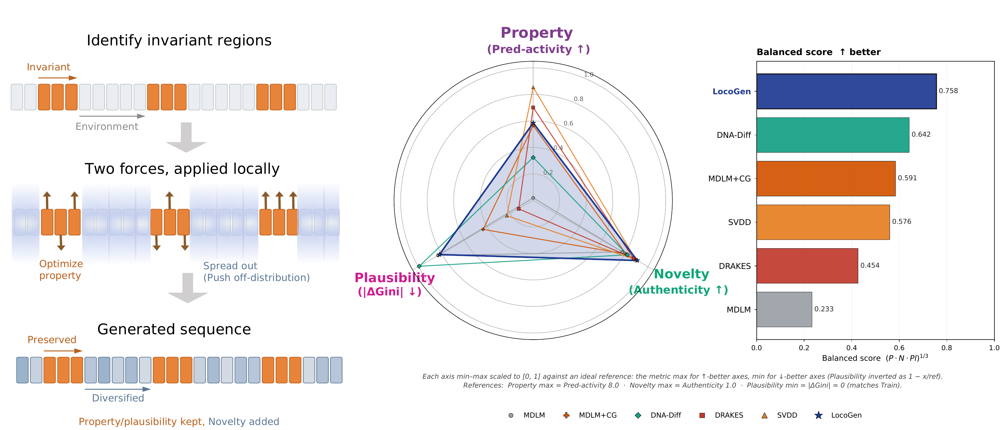

# LocoGen

> Locality-controlled guidance that steers a **frozen** masked diffusion language model toward high-activity enhancer DNA — no fine-tuning, no reward model training.

[](https://neurips.cc/Conferences/2026)
[](https://creativecommons.org/licenses/by/4.0/)
[](https://huggingface.co/DabinJeong/LocoGen)

<p align="center">
  
</p>

---

## 📖 Table of Contents

- [LocoGen](#locogen)
  - [📖 Table of Contents](#-table-of-contents)
  - [🚀 About the Project](#-about-the-project)
  - [✨ Key Features](#-key-features)
  - [🛠 Getting Started](#-getting-started)
    - [Prerequisites](#prerequisites)
    - [Installation](#installation)
  - [💻 Usage](#-usage)
    - [Stage 1 — Train the V-REx masked separator](#stage-1--train-the-v-rex-masked-separator)
    - [Stage 2 — Sample with LocoGen](#stage-2--sample-with-locogen)
    - [Stage 3 — Three-axis benchmark](#stage-3--three-axis-benchmark)
  - [⚙️ Dependencies](#️-dependencies)
  - [🗂 Repository Layout](#-repository-layout)
  - [📄 License](#-license)
  - [📚 Citation](#-citation)

---

## 🚀 About the Project

Locality-controlled guidance for masked discrete diffusion of regulatory DNA. LocoGen samples
enhancer sequences from a frozen MDLM (Sahoo et al., 2024) backbone — no fine-tuning — using a
V-REx-trained masked separator to localize the guidance gradient to invariant regulatory
positions.

The separator learns _where_ a sequence must be left alone: positions whose contribution to
measured activity is invariant across environments. Guidance and the off-distribution push
apply only outside them, so sequences keep their regulatory grammar while the background
diversifies — which is what lets property, novelty and plausibility improve together instead of
trading off.

This repository trains the separator (Stage 1), samples with LocoGen on a DRAKES MDLM backbone
(Stage 2), and reproduces the three-axis benchmark (Stage 3).

---

## ✨ Key Features

- **No fine-tuning** — the generative backbone stays frozen; nothing in it is retrained.
- **V-REx masked separator** — finds environment-invariant positions and confines the guidance gradient to them.
- **Localized OOD push** — `--ood_sil_localized` damps only separator-background positions.
- **Cell-type aware** — HepG2, K562 and SK-N-SH separators, checkpoints on the [Hugging Face Hub](https://huggingface.co/DabinJeong/LocoGen).
- **Reproducible benchmark** — property (Pred-activity, ATAC_acc), novelty (Authenticity, Rarity) and plausibility (|ΔGini|, |Δhits|) under `scripts/eval/`, with a manifest of the runs behind the reported numbers.

---

## 🛠 Getting Started

### Prerequisites

- **Python** ≥ 3.11, < 3.15
- **Poetry**
- **A CUDA GPU** — sampling and both reward oracles run on GPU
- **~6 GB free disk** — the DRAKES archive is ~5.3 GB zipped
- **Git** — the DRAKES backbone is cloned, not vendored here

### Installation

**1. Install the package**

```bash
pip install poetry
poetry install
eval $(poetry env activate)
```

**2. Clone the DRAKES code** — the backbone definition (`diffusion_gosai_update.py`), its hydra
config (`configs_gosai/config_gosai.yaml`) and the oracle loader (`oracle.py`):

```bash
git clone https://github.com/ChenyuWang-Monica/DRAKES.git
export LOCOGEN_DRAKES_REPO=$(pwd)/DRAKES/drakes_dna
```

**3. Download the DRAKES weights and data** — one ~5.3 GB archive holding the backbone, both
reward oracles and the Gosai dataset:

```bash
# DRAKES_data.zip — "All data and model weights" in the DRAKES README
wget -O DRAKES_data.zip "https://www.dropbox.com/scl/fi/zi6egfppp0o78gr0tmbb1/DRAKES_data.zip?rlkey=yf7w0pm64tlypwsewqc01wmfq&dl=1"
unzip DRAKES_data.zip          # extracts ./data_and_model/
export LOCOGEN_DRAKES_DATA=$(pwd)/data_and_model/
```

> [!NOTE]
> A Dropbox share link, so it may be rotated or expire. If it fails, take the current one from
> the [DRAKES README](https://github.com/ChenyuWang-Monica/DRAKES#readme).

LocoGen reads four files from it. Only `mdlm/` is needed — `pmpnn/` and `protein_*/` belong to
the DRAKES protein experiments.

| File, relative to `$LOCOGEN_DRAKES_DATA`                    | Size   | Used for              |
| ----------------------------------------------------------- | ------ | --------------------- |
| `mdlm/outputs_gosai/pretrained.ckpt`                        | 54 MB  | frozen MDLM backbone  |
| `mdlm/outputs_gosai/lightning_logs/reward_oracle_ft.ckpt`   | 2.8 GB | guidance oracle P_φ   |
| `mdlm/outputs_gosai/lightning_logs/reward_oracle_eval.ckpt` | 2.8 GB | held-out scoring only |
| `mdlm/gosai_data/processed_data/gosai_all.csv`              | 194 MB | Stage 1 training data |

> [!IMPORTANT]
> Mind the `lightning_logs/` level on the oracle paths. The two oracles are separately trained
> models, not copies: guidance uses `reward_oracle_ft.ckpt`, reported Pred-activity uses
> `reward_oracle_eval.ckpt`. Keeping them apart is what makes that metric non-circular.

**4. Link the dataset.** The Stage 1 configs default to `./data/gosai_all.csv`, which ships in
the same archive:

```bash
mkdir -p data
ln -s $LOCOGEN_DRAKES_DATA/mdlm/gosai_data/processed_data/gosai_all.csv data/gosai_all.csv
```

> [!WARNING]
> Both env vars (`LOCOGEN_DRAKES_REPO`, `LOCOGEN_DRAKES_DATA`) must be set before any
> `scripts/drakes_backbone/*` entry point.

<details>
<summary><b>About <code>gosai_all.csv</code> (data provenance)</b></summary>

DRAKES' repackaging of the Gosai et al. MPRA data: 735,156 rows, each a 200 nt `seq` plus
measured activity in `hepg2`, `k562` and `sknsh`. The original release is Supplementary Table 2,
"Processed MPRA data used to train Malinois", of [Gosai et al., _Machine-guided design of
cell-type-targeting cis-regulatory elements_, Nature
2024](https://doi.org/10.1038/s41586-024-08070-z); raw data and model weights are at
[Zenodo 10698014](https://zenodo.org/records/10698014), the RNA-seq reads under NCBI BioProject
[PRJNA1075667](https://www.ncbi.nlm.nih.gov/bioproject/?term=PRJNA1075667). LocoGen reads it
only via the DRAKES archive; the upstream links are provenance, not a second download.

</details>

---

## 💻 Usage

Train a separator, sample with it, score the samples. Stage 1 is optional — the released
checkpoints go straight to Stage 2.

### Stage 1 — Train the V-REx masked separator

The separator learns a binary mask over positions such that the masked sequence stays predictive
of activity _invariantly across environments_ (K-means clusters in its `x_en` embedding). Three
loss terms: invariance (V-REx penalty), L_reg (sparsity), L_smooth (mask smoothness).

```bash
python -m scripts.masked_separator_trainer \
    --config ./configs/enhancer_gosai_masked_separator_hepg2.yaml \
    --out_dir ./runs/masked_separator
```

Swap the config for cell-aware separators (`*_k562.yaml`, `*_sknsh.yaml`). The trainer writes
`masked_separator_total_epoch{N}.ckpt` each epoch, plus `masked_separator_best.ckpt`.

The checkpoints behind the reported numbers are released at
[`DabinJeong/LocoGen`](https://huggingface.co/DabinJeong/LocoGen) — download one to sample
without retraining.

### Stage 2 — Sample with LocoGen

The main entry point. λ controls the OOD push and `--alpha_ratio` the guidance strength; the
reference setting is `λ = 0.7, r = 3.0`. Fetch the separator for the cell line you want:

```bash
CKPT=$(python -c "from huggingface_hub import hf_hub_download; \
print(hf_hub_download('DabinJeong/LocoGen', 'hepg2/masked_separator.ckpt'))")
```

Full reference settings — `--lam` and `--alpha_ratio` alone do not reproduce the reported
numbers:

```bash
python -m scripts.drakes_backbone.mood_guided_sample_mdlm \
    --name locogen_hepg2 \
    --cell_type hepg2 \
    --ms_config ./configs/enhancer_gosai_masked_separator_hepg2.yaml \
    --ms_ckpt "$CKPT" \
    --lam 0.7 \
    --alpha_ratio 3.0 \
    --alpha_cap 20.0 \
    --ood_sil_localized true \
    --ood_sil_threshold 0.5 \
    --sil_t_threshold 0.3 \
    --num_samples 640 \
    --batch_size 64 \
    --seed 0
```

`--num_steps` stays at its default of 128; reported results average over seeds 0, 1 and 2.
Outputs are `sequences.csv` (one row per generated 200 nt sequence) and `summary.json` with the
run config.

`--ood_sil_localized` confines the OOD damping to separator-background positions. That is a
different mechanism from `--use_masked_separator`, which instead rewrites the reward as
`P_φ(x·M + bkg·(1-M))` and stays at its default `false` in the reported runs.

> [!CAUTION]
> Swap cell type, config and checkpoint **together**. A `--cell_type` / `--ms_config` mismatch
> aborts at startup — the config's `masked_separator.target_idx` is checked against the oracle
> head. `--ms_ckpt` is *not* validated, so a separator trained for another cell line loads
> silently and scores against the wrong oracle head.

```bash
    --cell_type k562 \
    --ms_config ./configs/enhancer_gosai_masked_separator_k562.yaml \
    --ms_ckpt "$(python -c "from huggingface_hub import hf_hub_download; \
print(hf_hub_download('DabinJeong/LocoGen', 'k562/masked_separator.ckpt'))")"
```

### Stage 3 — Three-axis benchmark

Every measurement script takes an explicit path, so any sequence CSV — a LocoGen run, your own
baseline, a sweep point, an ablation — scores directly:

```bash
# Property axis
python -m scripts.eval.property.pred_activity      --generated <csv> --cell_type hepg2
python -m scripts.eval.property.atac_accessibility --cell hepg2 --label locogen --csv <csv> \
                                                   --out_csv runs/atac_hepg2.csv
# Novelty axis
python -m scripts.eval.novelty.authenticity_rarity --generated <csv> --cell hepg2
# Plausibility axis
python -m scripts.eval.plausibility.motif_gini_hits --label locogen --csv <csv> \
                                                    --out_dir runs/motif_hepg2
```

Each writes an `eval_metrics.json` next to the sequences. Aggregate across seeds into the
reported mean ± std table:

```bash
python -m scripts.eval.aggregate_seeds --cell_type hepg2
# → runs/eval_aggregate_hepg2/eval_mean_std_hepg2.csv
```

`scripts/eval/manifest.py` is the roster `aggregate_seeds` reads, and the single source of truth
for the runs behind the reported numbers — λ=0.7, r=3.0 over 3 cell lines × 3 seeds:

```bash
python -m scripts.eval.manifest --count
python -m scripts.eval.manifest --list
python -m scripts.eval.manifest --index 5    # prints KEY=val lines
```

Not in this repository: the third-party baselines LocoGen is compared against (MDLM, SVDD,
DRAKES, DNA-Diffusion), whose samplers live upstream and whose sequences therefore cannot be
regenerated here; sweeps and ablations; and the LSF dispatcher and per-cell table assembly, which
live in the authors' research tree.

---

## ⚙️ Dependencies

- **Backbone:** frozen MDLM (Sahoo et al., 2024) via the [DRAKES](https://github.com/ChenyuWang-Monica/DRAKES) release — `pretrained.ckpt`
- **Oracles:** DRAKES reward oracles (`reward_oracle_ft` for guidance, `reward_oracle_eval` for scoring) and the 7-head ATAC classifier
- **Deep learning:** PyTorch 2.3.1, PyTorch Lightning, hydra-core, ml-collections, timm
- **Genomics:** gReLU, pyjaspar + Biopython (JASPAR PSSM scanning), selene-sdk
- **Data / tracking:** pandas, scipy, wandb, huggingface-hub

Pinned ranges live in `pyproject.toml`; `poetry install` is the only supported install path.

---
## 🗂 Repository Layout

<details>
<summary><b>Expand the directory tree</b></summary>

```
LocoGen/
├── pyproject.toml
├── locogen/                     # core package
│   ├── model/
│   │   ├── masked_separator.py   # V-REx separator + Y-head (CNN over soft one-hot)
│   │   ├── property_scorer.py    # K-member ensemble: mu_hat / sigma2_hat
│   │   └── property_regressor.py # single ensemble member (SeqRegressor)
│   ├── utils/
│   │   ├── train_utils.py
│   │   ├── grelu_compat.py       # loads DRAKES-era grelu checkpoints
│   │   ├── seq_io.py             # sequence loading / encoding
│   │   ├── seq_stats.py          # k-mer counts, Jensen-Shannon
│   │   └── jaspar.py             # JASPAR PSSM scanning
│   ├── metrics/                  # one file per reported metric
│   │   ├── authenticity.py       # Authenticity (Alaa et al. 2022)
│   │   ├── rarity.py             # Rarity (Han et al. 2023)
│   │   ├── motif_usage.py        # motif Gini, hits per sequence
│   │   └── kmer_features.py      # per-seq k-mer space, k-NN radii
│   └── datasets/
│       └── enhancer_gosai_dataset.py
├── scripts/
│   ├── masked_separator_trainer.py            # Stage 1: V-REx separator training
│   ├── drakes_backbone/
│   │   └── mood_guided_sample_mdlm.py         # Stage 2: LocoGen sampling
│   └── eval/                                  # Stage 3: three-axis benchmark
│       ├── manifest.py                        # (method, cell, seed) roster
│       ├── aggregate_seeds.py                 # mean ± std over 3 seeds
│       ├── property/
│       │   ├── pred_activity.py               # Pred-activity
│       │   └── atac_accessibility.py          # ATAC_acc
│       ├── novelty/
│       │   └── authenticity_rarity.py         # Authenticity, Rarity
│       └── plausibility/
│           └── motif_gini_hits.py             # |dGini|, |dhits|
└── configs/
    ├── enhancer_gosai_masked_separator_hepg2.yaml     # HepG2 separator
    ├── enhancer_gosai_masked_separator_k562.yaml      # K562 separator
    └── enhancer_gosai_masked_separator_sknsh.yaml     # SK-N-SH separator
```

</details>

---

## 📄 License

Distributed under the MIT License.

The DRAKES code, weights and the Gosai et al. MPRA data are not redistributed here and remain
under their own licenses.

---

## 📚 Citation

<!-- Update to the final NeurIPS 2026 entry on camera-ready. -->

